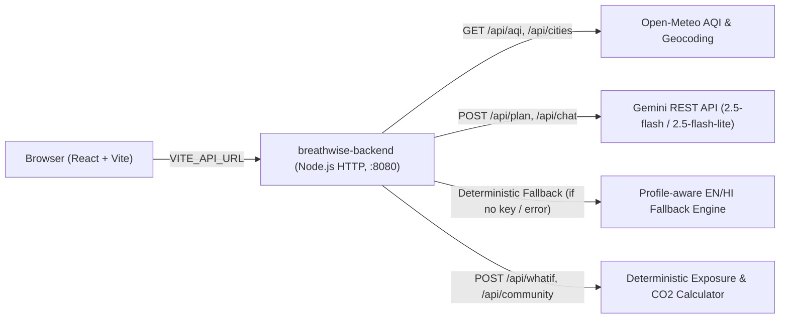

# Breathwise — Know Your Air. Change Your Day.

Breathwise is a bilingual (English + Hindi) urban air quality assistant built for Indian households. It turns raw AQI and pollutant readings into personalized daily routines, low-cost indoor air hacks, sustainable commute/cooking alternatives, an interactive What-If simulator, a community RWA/school toolkit, and an AI Q&A assistant.

---

## 1. Problem

Urban air quality apps typically show a single AQI number and generic "stay indoors" warnings. Families—especially households with children, elderly members, asthma/respiratory sensitivities, or limited budgets—need actionable, time-of-day, low-cost steps tailored to their home, commute, and cooking setup, plus a clear picture of how daily choices reduce PM2.5 exposure and emissions.

## 2. Approach

- **Frontend (React 19 + TypeScript + Vite + Tailwind CSS v4):** Clean, mobile-first bento UI with English/Hindi localization, light/dark themes, print/PDF export, downloadable community pledge cards, 20s request timeouts, 15s skeleton caps, retry controls, and explicit `"Using offline estimate"` indicators when fallback data is active.
- **Zero-Dependency Backend (`breathwise-backend/`, Node 22+):** Pure `node:http` + native `fetch` REST API with zero third-party npm packages, strict CORS allowlisting, 5-minute AQI caching, Gemini 2.5 Flash AI integration (`gemini-2.5-flash` with `gemini-2.5-flash-lite` retry), and deterministic, profile-aware offline fallbacks for every endpoint when `GEMINI_API_KEY` is absent or upstream calls fail.
- **Live Air Quality Data:** Open-Meteo Air Quality & Geocoding APIs (no API key required) with automatic fallback to curated city estimates.

## 3. Architecture



## 4. Repository Structure

```text
.
├── .env.local                    # Frontend env (VITE_API_URL=http://localhost:8080)
├── package.json                  # Frontend scripts + dev:all concurrent runner
├── src/
│   ├── App.tsx                   # Root state, onboarding, plan loading (15s cap)
│   ├── components/               # DashboardView, AskSaansView, WhatIfSimulator, CommunityView, etc.
│   ├── hooks/useSkeletonCap.ts   # 15s max skeleton guard
│   ├── services/
│   │   ├── api.ts                # fetch wrapper with 20s timeout & VITE_API_URL
│   │   ├── airQuality.ts         # /api/aqi, /api/cities, /api/cities/reverse
│   │   ├── ai.ts                 # /api/plan, /api/whatif, /api/chat, /api/community
│   │   └── mappers.ts            # Backend DTO -> Frontend domain model mappers
│   ├── types/saans.ts            # Frontend + Backend DTO types
│   └── utils/                    # AQI categories, impact math, local fallbacks
└── breathwise-backend/           # Zero-dependency Node.js backend
    ├── Dockerfile                # Cloud Run container (node:22-alpine, PORT=8080)
    ├── .env.example              # Backend env template
    ├── .env                      # Local backend env (paste GEMINI_API_KEY here)
    ├── server.mjs                # HTTP router, CORS, health, 1MB body limit
    ├── lib/                      # env, cors, aqi, gemini, plan, chat, whatif, community
    └── tests/backend.test.mjs    # Node test runner suite
```

## 5. Setup & Running Locally

### Prerequisites
- Node.js 22+

### 1. Configure API Key (Optional — works offline without it)
Open `breathwise-backend/.env` and paste your Gemini API key:
```env
GEMINI_API_KEY=your_gemini_api_key_here
PORT=8080
ALLOWED_ORIGINS=http://localhost:5173,http://127.0.0.1:5173
```

### 2. Install Frontend Dependencies & Run Both Servers
```bash
npm install --legacy-peer-deps
npm run dev:all
```
- Frontend: `http://localhost:5173`
- Backend: `http://localhost:8080`

### 3. Run Tests & Build
```bash
node --test breathwise-backend/tests/backend.test.mjs
npm run lint
npm run build
```

## 6. How Impact Is Estimated

- **Clean Air Score (0–100):** Starts from a profile baseline (`15–72`) based on commute mode, cooking fuel, road-facing windows, and heating method, then adds weighted boosts for active What-If actions (capped at `98`).
- **PM2.5 Exposure Reduction:** Sums percentage reduction factors for selected habits (capped at `68%`) and multiplies by ambient PM2.5 (`µg/m³`) to estimate indoor PM2.5 saved.
- **CO2 & Savings:** Multiplies per-action weekly CO2 (`kg/week`) and fuel/energy savings (`₹/week`) by selected frequency/toggles.
- **Community Mode:** Scales per-household monthly CO2 (`kg/home/mo`) and PM dust (`g/home/mo`) across `10–500` participating households, converting CO2 avoided to monthly tree-absorption equivalents (`CO2 / 1.8`).

## 7. Deployment (Google Cloud Run + Firebase Hosting)

### Backend → Google Cloud Run (`asia-south1`)
```bash
cd breathwise-backend
gcloud run deploy breathwise-backend \
  --source . \
  --region asia-south1 \
  --allow-unauthenticated \
  --set-secrets="GEMINI_API_KEY=GEMINI_API_KEY:latest" \
  --set-env-vars="ALLOWED_ORIGINS=https://your-frontend-domain.web.app"
```

### Frontend → Firebase Hosting (or Cloud Run)
```bash
# Set VITE_API_URL to your Cloud Run backend URL
echo "VITE_API_URL=https://breathwise-backend-xxxxx-el.a.run.app" > .env.production
npm run build
firebase deploy --only hosting
```

## 8. Limitations

- Impact figures (PM2.5 reduction %, CO2 avoided, rupee savings, tree equivalents) are directional household estimates, not clinical or sensor-calibrated measurements.
- Health guidance is informational only and not medical advice.
- When `GEMINI_API_KEY` is not configured, AI endpoints (`/api/plan`, `/api/chat`) serve deterministic, profile-aware offline fallback responses (`source: "fallback"`, `demo: true`).
